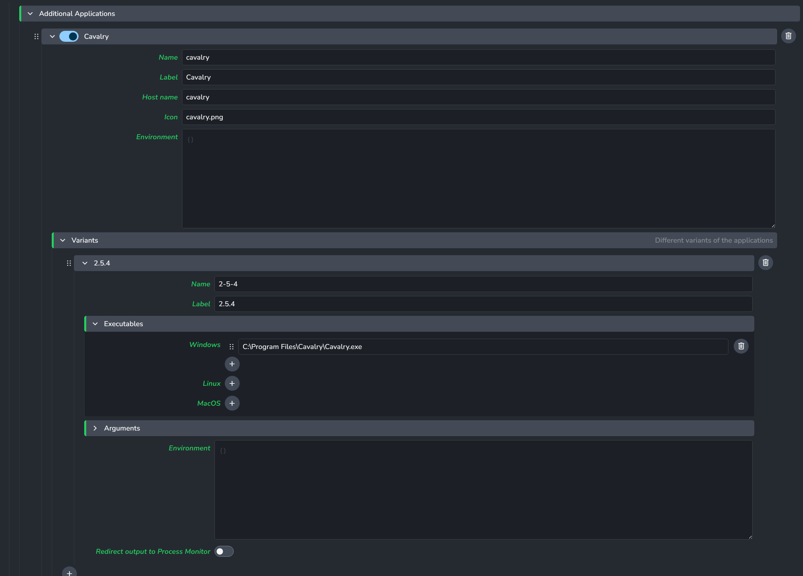

# Working with Cavalry in AYON

> **Important:** To use Cavalry with AYON, you must have **[Cavalry PRO](https://cavalry.scenegroup.co/pricing/)**. Rendering using Deadline or through the CLI requires the **Enterprise** edition of Cavalry.

> **Note:** Cavalry version 2.6 is currently broken—CLI/Deadline rendering will **not** work on Windows with this version. The latest supported version for reliable Deadline and CLI rendering is **2.5.4**.

This document explains how to use the Cavalry addon with AYON. [Cavalry](https://cavalry.scenegroup.co/pricing/) is a 2D motion design application, and the AYON addon enables workfile management, asset loading, publishing renders, and integration with Deadline for farm rendering.

## Dependencies

Deadline integration will **not** work without this custom AYON Deadline addon. Ensure that both the Cavalry addon and the [Custom AYON Deadline Addon](https://github.com/vinlof/ayon-deadline) are included in the production bundle and are properly installed on the server.

Check with the pipeline administrator if you’re unsure whether the required AYON Deadline addon is present.

## Add Cavalry as an Application

Before artists can launch Cavalry via AYON, an administrator must add Cavalry to the Applications addon. This registers Cavalry as a launchable application so it appears in the AYON Launcher.

1. Open **AYON Settings** (requires admin access).
2. Go to **Applications** > **Additional Applications**.
3. Click **Add application** and select **Cavalry** from the list (or add a custom application if Cavalry is not listed).
4. Configure the application:
   - **Executable**: Path to the Cavalry executable (e.g. `C:\Program Files\Cavalry\Cavalry.exe` on Windows, or the Cavalry app path on macOS).
   - **Label**: Display name shown in the launcher (e.g. "Cavalry").
   - **Version**: Optional, to support multiple Cavalry versions.

Once configured, Cavalry will appear in the AYON Launcher and artists can launch it from there. Ensure the Cavalry addon is also enabled in your production bundle so the AYON panel and pipeline tools are available.

## AYON Panel Installation

Once your admin has activated `Cavalry` in the production bundle, you need to run the AYON launcher at least once. This allows the launcher to download the addon to the correct location on your computer. After that, the AYON panel script is installed automatically when you launch Cavalry via AYON.

### Automated Installation

This is handled by `auto_install_script` (enabled by default in project settings). When you launch Cavalry via the AYON Launcher:

1. The pre-launch hook copies the AYON panel script to Cavalry's Scripts folder.
2. The script appears in Cavalry under `Window > Scripts > AYON > ayon_panel`.

If you see the AYON panel when you go to `Window > Scripts > AYON`, the extension is installed. No manual steps required.

### Manual Installation

If automatic installation fails or you need to install the panel manually:

**Windows**

1. Locate the AYON panel script in your addons folder, typically at:
   `%LOCALAPPDATA%\Ynput\AYON\addons\cavalry_0.0.1\ayon_cavalry\api\js\ayon_panel.js`
2. Create the folder `%APPDATA%\Cavalry\Scripts\AYON\` if it does not exist.
3. Copy `ayon_panel.js` into that folder.
4. If present, also copy the `ayon_panel_assets` folder (for status icons) into the same directory.

**macOS**

1. Locate the script at `~/Library/Application Support/Ynput/AYON/addons/cavalry_0.0.1/ayon_cavalry/api/js/ayon_panel.js`
2. Create the Cavalry Scripts folder (see Cavalry documentation for the exact path) and copy the script there.

## Implemented Functionality

The Cavalry addon currently allows you to:

- Import and add various media to compositions (image plates, renders, prerenders, reviews, workfiles, and Cavalry scenes)
- Create render instances from compositions and publish them
- Render locally in Cavalry or send jobs to Deadline
- Use existing pre-rendered frames for publishing
- Manage workfiles and scene inventory

## Launch Cavalry

Cavalry is supported on Windows and macOS (Linux is not supported by Cavalry). AYON works with Cavalry when launched via the AYON Launcher. Having multiple instances of Cavalry running at the same time may lead to unexpected behavior.

When you launch Cavalry via the AYON Launcher, the Workfiles app may open first. If you do not have any previous workfiles, you can close this window.

The Workfiles tool saves your `.cv` files in the correct location and with the correct naming. Use it instead of the standard file save dialog.

## AYON Tools

Once the AYON panel is installed, open it via `Window > Scripts > AYON > ayon_panel`. The panel provides:

**AYON Global Tools**

- **Workfiles** — Open, save, and manage workfiles
- **Load** — Load published products into the scene
- **Publish** — Open the Publisher to publish instances
- **Create** — Creates a render instance from the selected composition. With exactly one composition selected, prompts for a variant name first.
- **Manage** — Open the Scene Inventory to manage loaded containers and versions
- **Set Resolution** — Set composition width and height according to AYON folder/task attributes. Select composition(s) first.
- **Set Frame Range** — Set start and end frame in the composition according to AYON folder/task attributes. Select composition(s) first.

## Publish

When you are ready to share your work, open the Publisher via the `Publish` button in the AYON panel.

There is always a workfile instance created automatically (see the workfile item in the Products to publish column). This allows you to publish (and backup) the workfile used to produce other publishable elements.

The main publishable item in Cavalry is of `render` product type. The result is an image sequence or video that can be used as final delivery or loaded into other DCCs.

**To create a render instance:**

1. Select one or more compositions in the Scene Window.
2. Click `Create` in the AYON panel (or use the Creator tool within the Publish window).
3. Configure the variant name and options if prompted.
4. The render instance appears in the Publisher.

> **Tip:** You can configure render settings, such as file format and output resolution, in Cavalry’s Render Queue settings. To quickly open the Render Queue settings, press **Alt + B**. This allows you to control settings like the export format (PNG, EXR, MP4, etc.) before running a render.

**Render instance options:**

- **Use selection** — Use only selected compositions (default: on). When off, all compositions in the scene are used.
- **Use composition name in product** — Include the composition name in the product name (e.g. `renderMain_CompA`).
- **Render target** — Choose:
  - **Local machine rendering** — Render in Cavalry on your machine
  - **Use existing frames** — Publish already-rendered files
  - **Render on farm (Deadline)** — Submit to Deadline (requires Deadline addon)
- **Review** — Mark the first representation for review

The product name can be configured with a template in `project_settings/global/tools/creator/product_name_profiles` (admin access required).

## Render Queue

Cavalry's Render Queue is used for publishing locally or on the farm. When you create a render instance via AYON, a Render Queue item is created automatically and the output path is set (typically under the workfile directory). The output format (PNG, MP4, etc.) is defined by Cavalry's Render Queue settings (see above for how to access and edit these). AYON collects the rendered files from the configured output location after rendering.

> **Important:** AYON creator instances are saved as metadata on the corresponding Render Queue items in the Cavalry scene. If you remove or clear items from the Render Queue, any associated publish instances and their metadata will be permanently lost. 

## Load

Use the Loader tool (via the `Load` button in the AYON panel) to load published work into Cavalry.

**Supported product types for loading:**

- `image`
- `plate`
- `render`
- `prerender`
- `review`
- `workfile`

To load an item, right-click on the product and choose the representation you want to load. Loaded assets are placed in the active composition at the current playhead.

## Manage

Use the Scene Inventory (via the `Manage` button in the AYON panel) to manage loaded containers. You can switch to a different version of a loaded asset or update to the latest version.

Loaded assets remain as footage layers in the Asset Window so they can be updated via the Scene Inventory. If you change or delete the layer in a way that breaks the link, you may no longer be able to update it via AYON tools.

## Addon Settings

Cavalry addon settings are available under Project Settings > Cavalry:

**Creator**

- **Rename Composition to Product Name** — When creating a render instance, rename the source composition to match the product name.
- **Force Settings from AYON** — When creating a render, apply fps, frame range, and resolution from the folder/task attributes to the composition (default: off).

**Publish**

- **Validate Scene Settings** — Enable validation that checks composition settings against AYON folder/task attributes before publishing.
- **Increment Workfile on Publish** — Automatically increment the workfile version after a successful publish.

## Environment Variables

| Variable | Default | Purpose |
|----------|---------|---------|
| `AYON_CAVALRY_PYTHON_PORT` | 8098 | Python HTTP server port |
| `AYON_CAVALRY_WEBSERVER_PORT` | 8099 | Cavalry WebServer port |

These are set automatically when launching via AYON. Change them only if you need to avoid port conflicts.
